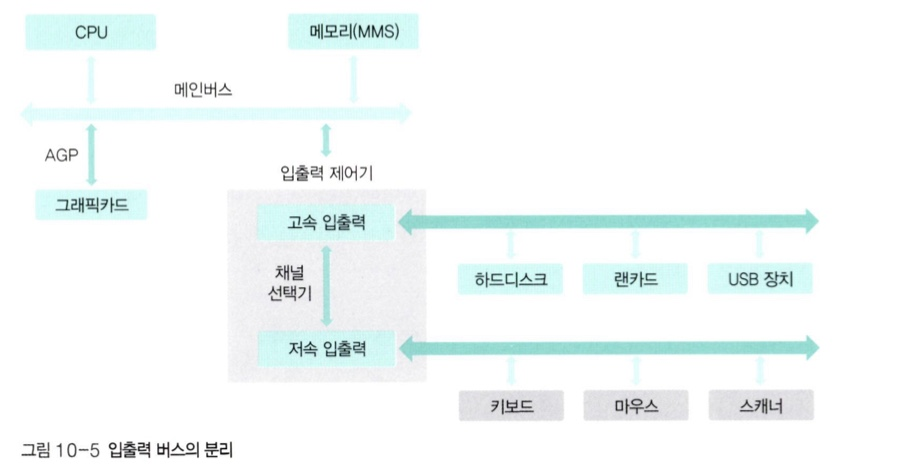

# 입출력 시스템

> 입출력 시스템 : 속도가 다른 주변장치들과 CPU·메모리 사이의 데이터 이동을 효율적으로 처리하는 구조

## 입출력장치와 채널

- 주변장치는 **데이터 전송 속도**에 따라 나뉨

| 구분 | 예 |
|---|---|
| 저속 주변장치 | 키보드, 마우스 |
| 고속 주변장치 | 하드디스크, 그래픽카드 |

- **채널** : 데이터가 지나다니는 하나의 통로. 속도가 비슷한 장치끼리 묶어 같은 채널에 배정

---

## 입출력 버스의 구조

**발전 과정**

| 단계 | 구조 | 특징 |
|---|---|---|
| 초기 | CPU가 **폴링** 으로 장치 상태를 주기적 확인 | CPU 낭비 심함 |
| 발전 | **입출력 제어기**와 입출력 버스 도입 | CPU는 작업 지시만 하고 결과는 인터럽트로 통보받음 |
| 현대 | 입출력 버스를 다시 그래픽·고속·저속 버스로 세분화 | 느린 장치가 빠른 버스를 점유하는 문제 해결 |

- 메인 버스 : CPU ↔ 메모리 
- 그래픽 버스 : CPU ↔ 그래픽카드
- 고속 입출력 버스 : 고속 주변 장치 연결
- 저속 입출력 버스 : 저속 주변 장치 연결

{ width=500 }

---

## 직접 메모리 접근

> DMA : CPU를 거치지 않고 입출력장치가 메모리에 직접 읽고 쓰는 방식

- 원래 메모리 접근 권한은 CPU에만 있음
- **DMA 제어기**에 메모리 접근 권한을 부여 → 대량 데이터 전송을 CPU 없이 수행
- 전송이 끝나면 인터럽트로 CPU에 완료 통보
- memory-mapped I/O - CPU용 메모리 공간과 DMA용 공간을 구분해 관리하는 것

---

## 인터럽트

> 인터럽트 : 입출력 완료 같은 이벤트를 CPU에 알리는 신호 

**처리 흐름**

1. CPU가 입출력 제어기에 작업 지시 후 다른 일 수행
2. 장치가 작업 완료 → **인터럽트 발생**
3. CPU는 **인터럽트 벡터**에서 번호에 해당하는 처리 루틴을 찾음
4. **인터럽트 핸들러** 실행 → 원래 작업 복귀

---

## 단일 버퍼와 이중 버퍼

> 버퍼 : 속도가 다른 두 장치 사이의 데이터를 모아 한꺼번에 전송하는 임시 저장 공간

| 방식 | 동작 | 특징 |
|---|---|---|
| 단일 버퍼 | 버퍼 하나를 채우고 → 비우고 반복 | 생산과 소비 동시 진행 불가  |
| 이중 버퍼 | 버퍼 두 개 — 하나는 **채우고** 동시에 다른 하나는 **비움** | 생산과 소비가 동시에 진행, 효율 상승 |

---

## 🔑 최종 정리

> 한 줄 요약: 입출력 시스템은 저속·고속 장치를 버스로 묶고, 폴링 대신 인터럽트로 완료를 통보받으며, DMA가 CPU 없이 메모리에 직접 대용량 데이터 전송을 수행하고, 속도 차이는 버퍼로 완화한다
