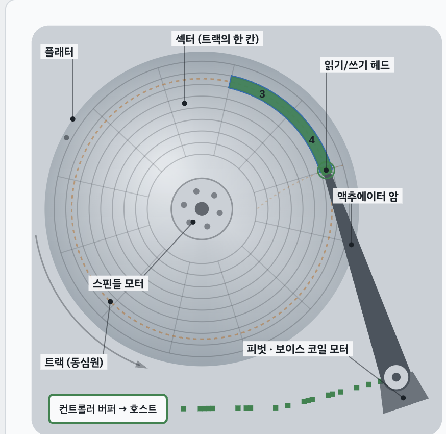
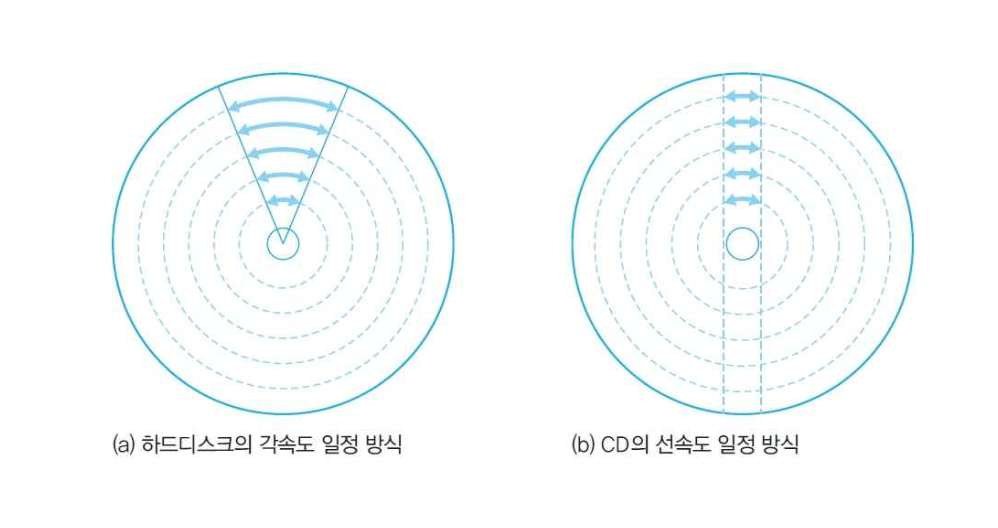

# 저장장치

## 저장장치의 종류

**하드디스크**

{width = 300}

| 구성 요소 | 내용 |
|---|---|
| 플래터 | 데이터가 기록되는 원판 - 2개 표면 이용 |
| 트랙  | 플래터 위의 동심원 |
| 섹터  | 트랙을 나눈 조각 — **최소 저장 단위** |
| 헤드  | 데이터를 읽고 쓰는 부품 |

**기타 저장장치**

| 장치 | 특징 |
|---|---|
| SSD | 플래시 메모리 기반 — 빠르고 조용, 충격에 강함, 비쌈 |
| CD | 원반 사용 - 트랙과 섹터로 구성 |

**하드디스크와 CD의 비교**

| 방식 | 내용 | 예 |
|---|---|---|
| 각속도 일정 | 회전 속도 일정 — 바깥 트랙일수록 데이터 밀도 낮음  |
| 선속도 일정 | 트랙 위치에 따라 회전 속도 조절 — 밀도 일정 |

{width = 400}

---
## 디스크 장치의 데이터 전송 시간

> 디스크 접근 시간 = 탐색 시간 + 회전 지연 시간 + 전송 시간

| 구성 | 내용 | 비중 |
|---|---|---|
| 탐색 시간  | 헤드를 목표 **트랙** 까지 이동하는 시간 | **가장 큼** |
| 회전 지연 시간  | 목표 **섹터**가 헤드 아래로 회전해 올 때까지 기다리는 시간 | 중간 |
| 전송 시간  | 실제로 데이터를 읽어 전송하는 시간 | 작음 |

- 성능 개선의 핵심 = **탐색 시간 최소화** → 디스크 스케줄링 알고리즘의 목표

---

## 🔑 최종 정리

> 한 줄 요약: 하드디스크는 플래터·트랙·섹터·실린더·헤드로 구성되고   접근 시간은 탐색+회전 지연+전송 시간의 합이다.   탐색 시간이 가장 커서 디스크 스케줄링의 대상이 된다.
