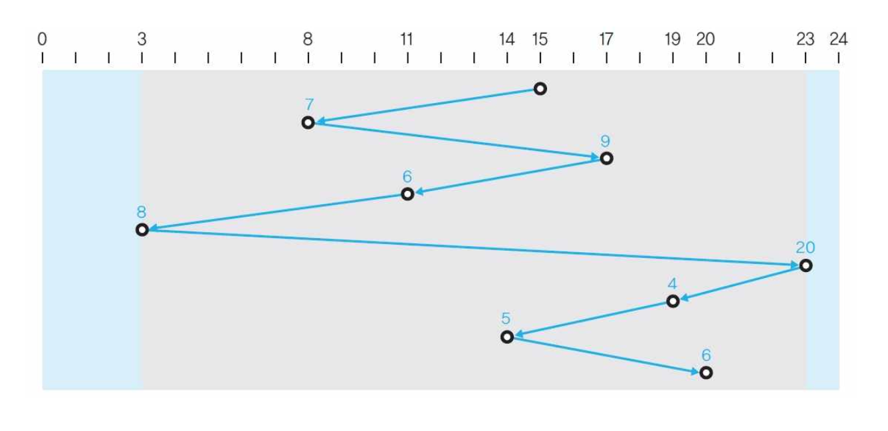
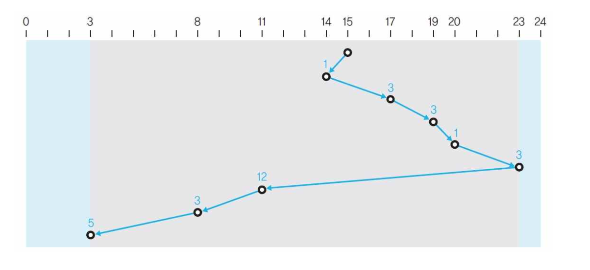
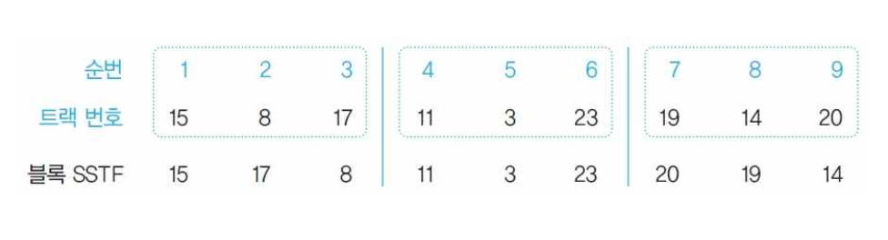
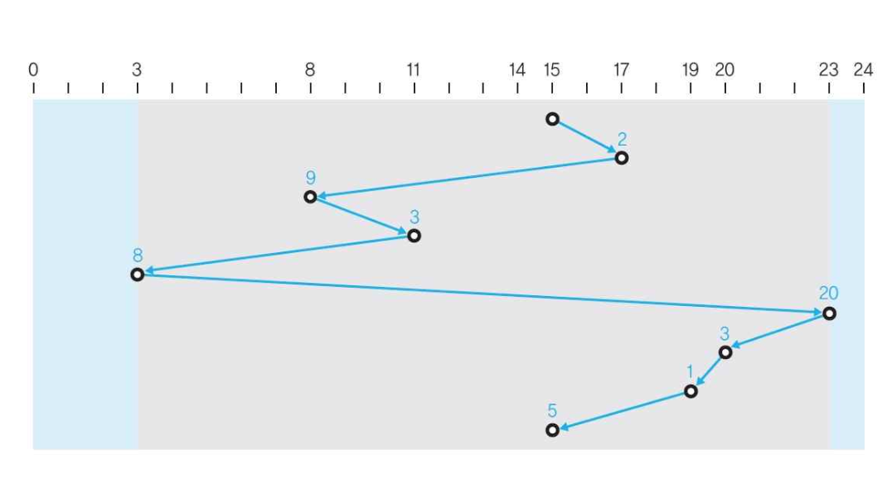
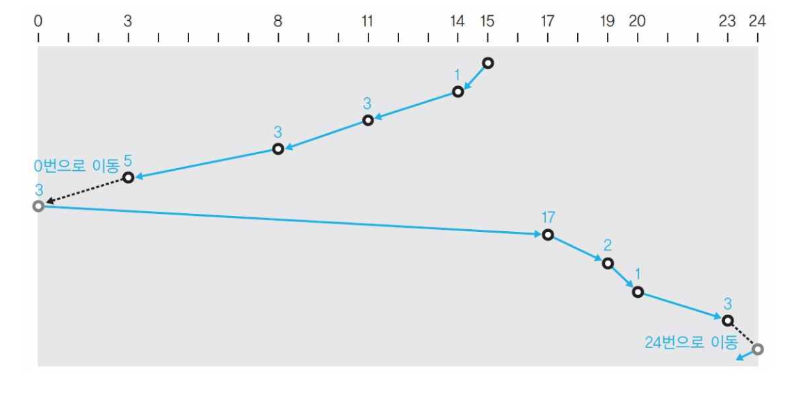
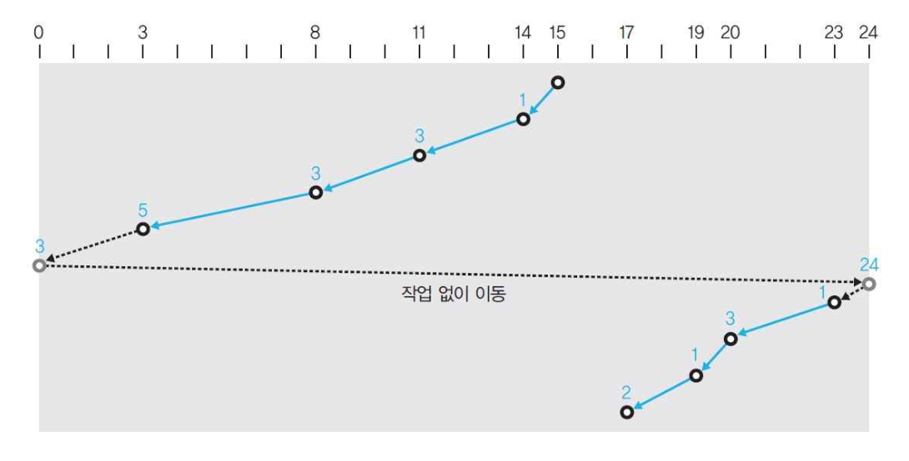
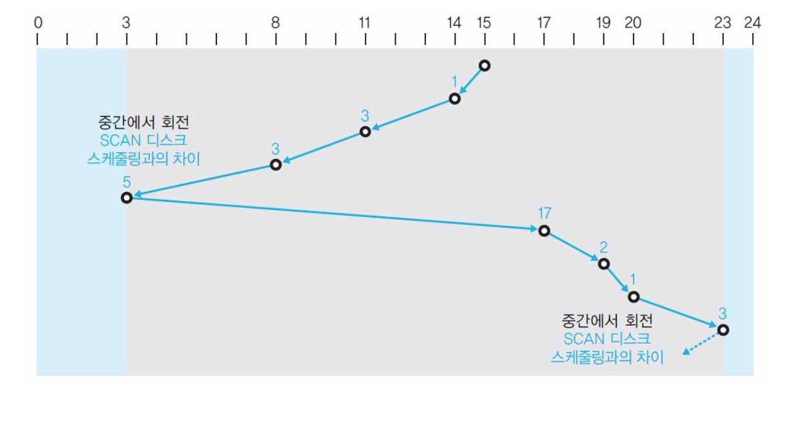
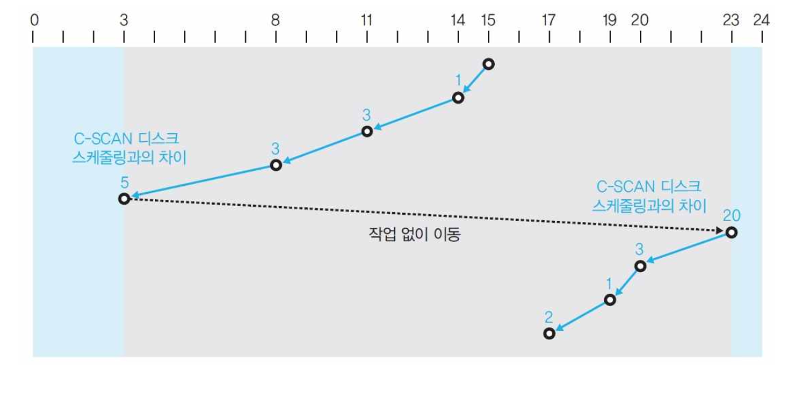

# 디스크 스케줄링

> 디스크 스케줄링 : 트랙의 이동을 최소화 해 탐색 시간을 줄이는 것 

## FCFS 디스크 스케줄링

> 들어온 순서대로 처리

- 구현 가장 단순

{width = 500}

---

## SSTF 디스크 스케줄링

> 현재 헤드 위치에서 가장 가까운 요청부터 처리 

- 이동 거리 관점에서 효율적
- 문제 : 먼 곳의 요청은 계속 밀리는 **아사 현상**

{width = 500}

---

## 블록 SSTF 디스크 스케줄링

> 요청을 일정 블록으로 나누고, 블록 안에서만 SSTF 적용

- 블록 단위로는 들어온 순서 보장 → **아사 방지**
- 블록 안에서는 SSTF → 어느 정도 효율 유지

{width = 500}
{width = 500}

---

## SCAN 디스크 스케줄링

> 헤드가 한쪽 끝에서 반대쪽 끝까지 이동하며 경로상의 요청을 모두 처리 

- 끝에 도달하면 방향을 바꿔 반대로 이동하며 처리
- SSTF의 아사 문제 완화
- 문제 : **중앙 트랙**은 헤드가 자주 지나가고 **바깥족 트랙**은 드물게 지나감 

{width = 500}

---

## C-SCAN 디스크 스케줄링

> 한 방향으로만 처리하고, 반대 방향은 서비스하지 않고 이동만 한다

- 모든 트랙이 같은 빈도로 서비스받음 
- 작업 없이 헤드를 이동하는 비효율 발생

{width = 500}

---

## LOOK 디스크 스케줄링

> 디스크 끝까지 가지 않고, 마지막 요청 위치에서 방향 전환

- 불필요한 끝까지의 이동 제거 → SCAN보다 효율적

{width = 500}

---

## C-LOOK 디스크 스케줄링

> C-SCAN의 공평성 + LOOK의 이동 절약

{width = 500}

---

## SLTF 디스크 스케줄링

> 모든 트랙을 읽을 수 있는 여러 개 헤드 부착 - 회전 지연 시간이 가장 짧은 요청부터 처리

- 탐색 시간이 없으므로 **회전 지연**만 최소화하면 됨
- 섹터 위치 순서대로 큐를 재배열

---

## 🔑 최종 정리

> 한 줄 요약: 디스크 스케줄링은 헤드 이동을 줄이기 위한 요청 재배열로, FCFS→SSTF→블록 SSTF→SCAN/C-SCAN→LOOK/C-LOOK으로 발전했다.
