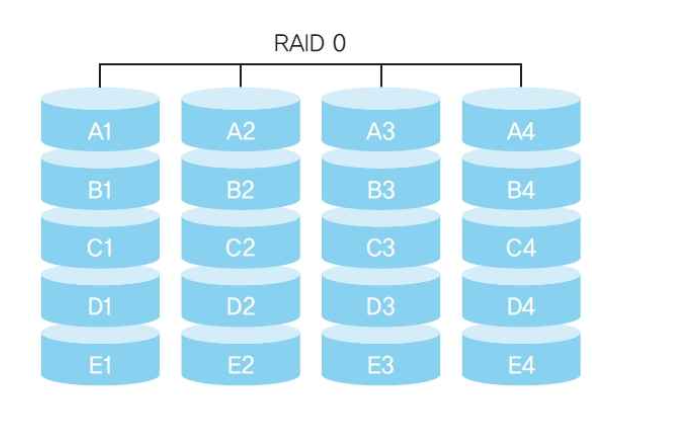
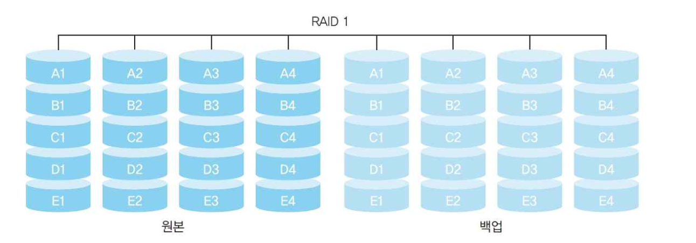
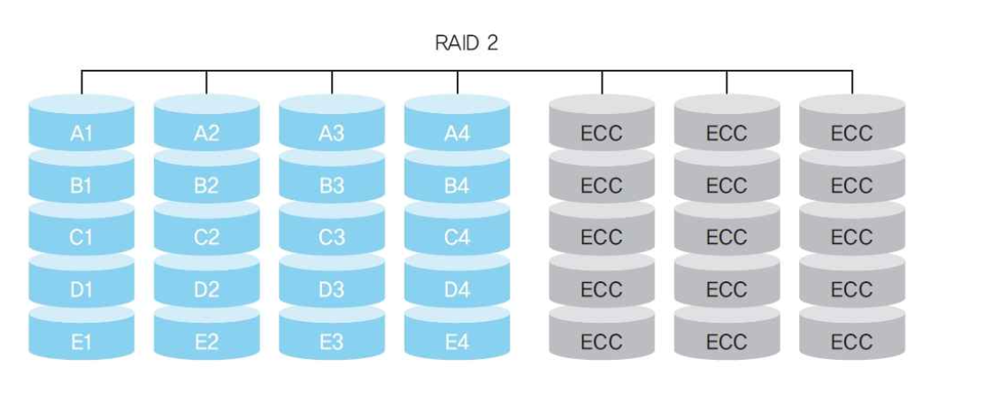
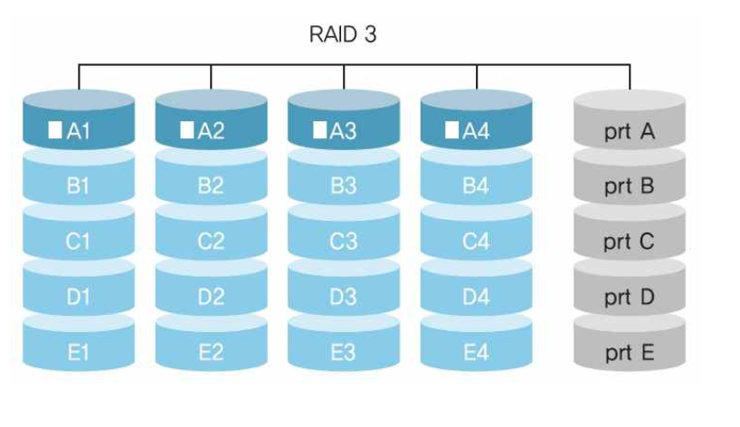
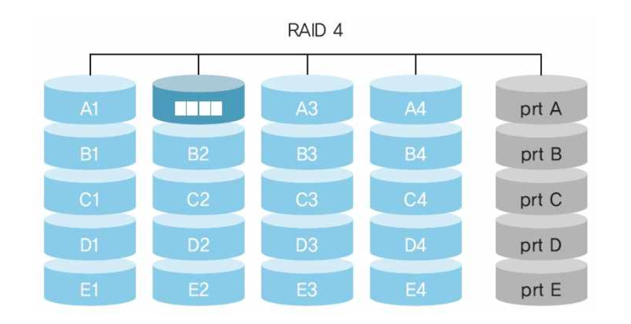
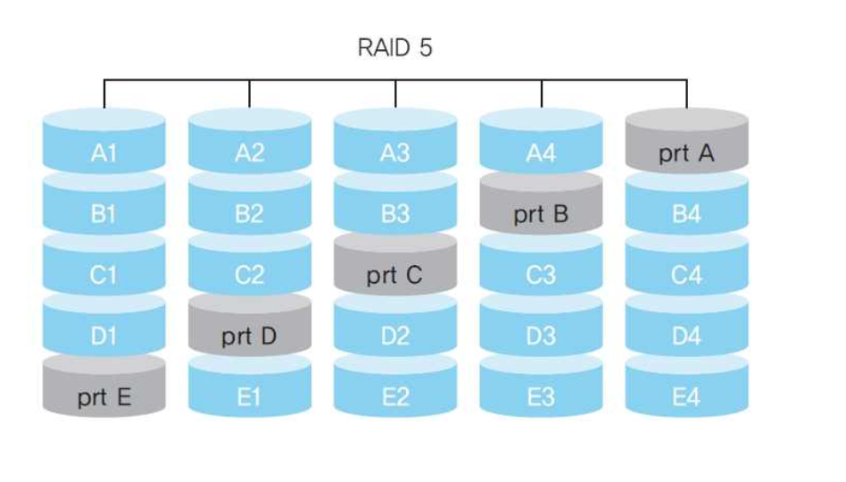
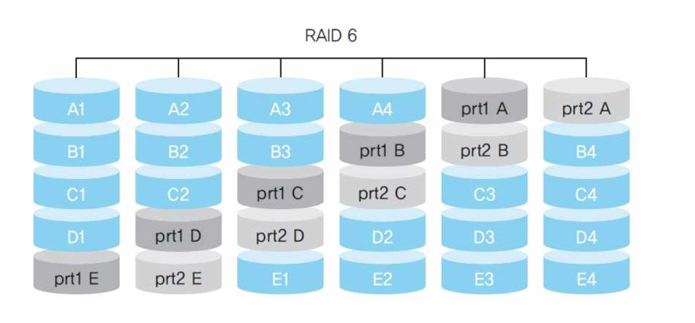
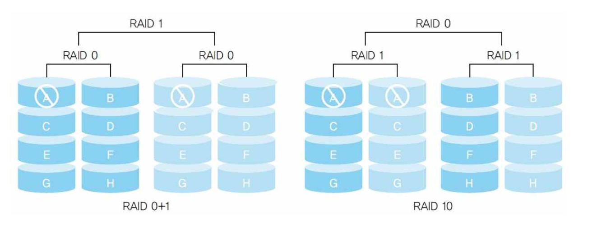
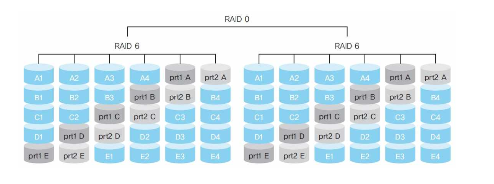

# RAID

> RAID : 여러 디스크를 묶어 장애에 대비하거나 속도를 높이는 기술

## RAID의 개요

| 목표 | 수단 |
|---|---|
| 안정성 | 같은 데이터를 여러 디스크에 **중복 저장**, 또는 패리티로 복구 |
| 성능 | 데이터를 여러 디스크에 나눠 **병렬로 읽고 쓰기** |

| 핵심 용어 | 내용 |
|---|---|
| 미러링  | 같은 데이터를 다른 디스크에 복사 |
| 스트라이핑  | 데이터를 쪼개 여러 디스크에 분산 저장 |
| 패리티  | 데이터 복구용 추가 정보 — 디스크 1개 고장 시 나머지+패리티로 복원 |

---

## RAID 0 (스트라이핑)

- 데이터를 N개 디스크에 나눠 **동시에 입출력** 
- **장애 대비 없음** 

{width = 500}

---

## RAID 1 (미러링)

- 같은 데이터를 **두 디스크에 복사** 저장
- 하나가 고장 나도 데이터 보존 
- 비용 증가, 속도 저하

{width = 500}

---

## RAID 2

- 비트 단위 스트라이핑 + **해밍 코드** 전용 디스크로 오류 검출·복구
- 해밍 코드 디스크가 N-1 개 필요

{width = 500}

---

## RAID 3

- **섹터 단위** 스트라이핑 + 패리티 전용 디스크
- 추가되는 디스크 양이 4개당 1개 정도로 경제적

{width = 500}

---

## RAID 4

- **블록 단위** 스트라이핑 + 패리티 전용 디스크 
- 패리티 비트 구성을 위해 모든 디스크가 동시에 동작 - 데이터 병목

{width = 500}

---

## RAID 5

- **패리티를 모든 디스크에 분산** 저장 - RAID 4의 병목 해결 
- 디스크 1개 고장까지 복구 가능

{width = 500}

---

## RAID 6

- **패리티를 2개** 저장 
- **디스크 2개 동시 고장**까지 복구 가능

{width = 500}

---

## RAID 10

- **RAID 1  + RAID 0** 조합
- 미러링된 쌍들을 스트라이핑 → 속도와 안정성 동시 확보

{width = 500}

---

## RAID 50과 RAID 60

{width = 500}

---

## 🔑 최종 정리

> 한 줄 요약: RAID는 여러 디스크를 묶어 속도와 안정성을 얻는 기술로, RAID 0은 속도만, 1은 복사, 5는 패리티 분산, 6은 이중 패리티, 10은 미러링+스트라이핑 조합이다
