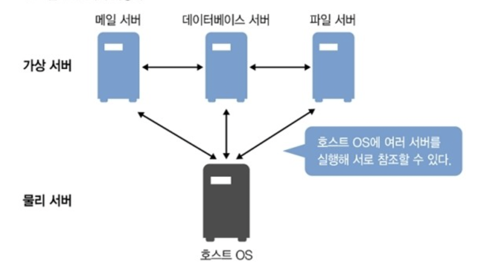
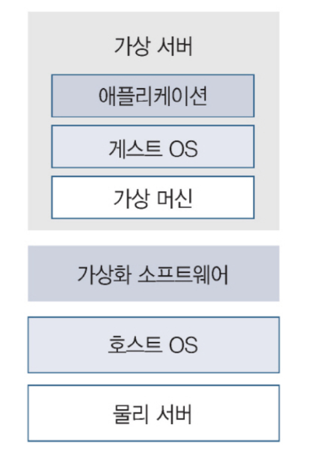

# 가상화

> 실체가 없는 것을 마치 존재하는 것처럼 보이게 하는 기술

## 가상화란

- 물리 서버를 늘리지 않고 필요에 따라 서버를 늘릴 수 있음
- 실제로는 서버가 여러 대 있어도 사용자는 서버 1대로 보이게 할 수도 있음

{ width=600, height=800 }

---

## 가상화의 개념

- 물리 서버가 가장 아래에 있고, 호스트 OS, 가상화 소프트웨어, 가상 서버가 존재한다
- 가상화 소프트웨어 : 가상 서버를 실행하는 데 필요한 소프트웨어

{ width=600, height=800 }

---

## 가상화의 유연성

- 물리적 구성에 얽매이지 않고 유연하게 환경 구축 가능
- 예 : 물리 서버 OS - Windows, 가상 서버 OS : Ubuntu

---

## 가용성 향상

> 가용성 : 시스템이 멈추지 않고 계속 서비스를 제공할 수 있는 정도

- 생성한 가상 환경별로 백업해서 복원하는 것이 가능
- 바로 이전 상태로 되돌려 시스템 가용성 향상
- 다만, 물리 서버가 꺼지면 가상 서버도 사용할 수 없음

---

## 🔑 최종 정리

> 한 줄 요약: 가상화는 실체가 없는 것을 존재하는 것처럼 만드는 기술로, 물리 구성에 얽매이지 않고 유연하게 환경 구축이 가능하며 가용성을 높일 수 있다
