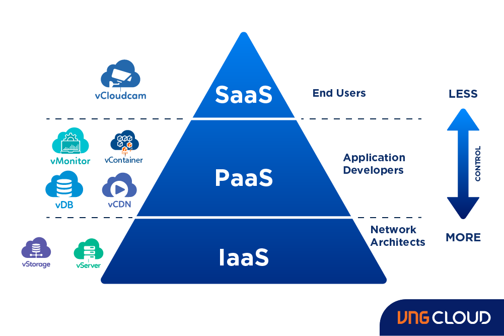

# 가상화와 클라우드

> 클라우드 : 가상화 기술로 구축된 인프라나 서비스

## 클라우드란

- 인터넷을 통해 접근해 다양한 인프라와 서비스 이용 가능
- AWS, GCP, Azure등이 유명한 클라우드 서비스

**서비스 모델**

| 모델 | 제공 범위 | 사용자 관리 범위 | 예 |
|---|---|---|---|
| SaaS | 완성된 애플리케이션 | 사용만 | Gmail |
| PaaS | 인프라 + OS·실행 환경 | 애플리케이션, 데이터 | Google App Engine |
| IaaS | 서버·네트워크·저장장치 | OS, 미들웨어, 애플리케이션 | Amazon EC2 |

{ width=600, height=800 }

**배치 모델**

| 모델 | 내용 |
|---|---|
| 퍼블릭 클라우드 | 사업자의 자원을 불특정 다수가 공유 |
| 프라이빗 클라우드 | 한 조직 전용으로 구축 |
| 하이브리드 클라우드 | 퍼블릭 + 프라이빗(또는 온프레미스)을 연결해 사용 |
| 멀티 클라우드 | 여러 사업자의 클라우드를 함께 사용 |

---

## 클라우드를 지탱하는 가상화

> 원드라이브(OneDrive) 같은 온라인 스토리지 서비스(SaaS)를 예로 살펴본다

**스토리지 가상화**

- 원드라이브는 사용자당 5GB를 제공하지만, 실제로 `사용자 수 × 5GB`의 디스크를 확보하고 있지는 않음
- 미리 준비된 디스크에서 필요에 따라 사용자마다 디스크 공간을 할당
- 물리적 디스크 공간과 다른 **논리적 영역**을 보여 주는 기술 = 스토리지 가상화

| 구분 | 내용 |
|---|---|
| 사용자에게 보이는 디스크 | 각자 5GB의 디스크가 할당된 것처럼 보임 |
| 실제 디스크 | 공유 디스크 — 사용자가 5GB를 초과하지 않도록 관리만 함 |

- 5GB를 모두 쓰지 않는 사용자의 남는 공간도 유효하게 활용 가능

**서버 가상화**

- 접속하는 서버도 가상화되어 있음
- 사용자에게는 서버가 하나로 보이지만, 실제로는 여러 서버가 역할을 담당
- 목적 : 역할 분산, 로드 밸런싱, 리스크 분산

---

## 클라우드를 지탱하는 분산 처리

> 분산 처리 : 하나의 큰 작업을 여러 대의 컴퓨터에 **나눠서** 처리하는 방식

- 대규모 서비스는 고성능 서버 한 대(스케일 업)로는 한계 → 여러 대로 나눠 처리(**스케일 아웃**)
- 가상화로 서버를 쉽게 늘릴 수 있으므로 분산 처리와 궁합이 좋음

| 요소 | 내용 |
|---|---|
| 로드 밸런서 | 요청을 여러 서버에 분배 |
| 오토 스케일링 | 부하에 따라 서버 대수를 자동 증감 |
| 분산 스토리지 | 데이터를 여러 서버에 복제·분산 저장 |
| 리전 / 가용 영역(AZ) | 지리적으로 떨어진 데이터 센터에 분산 배치 → 재해 대비 |

| 구분 | 스케일 업 | 스케일 아웃 |
|---|---|---|
| 방법 | 서버 사양을 높임 | 서버 대수를 늘림 |
| 한계 | 하드웨어 상한 존재 | 이론상 계속 확장 |
| 장애 | 한 대 고장 = 서비스 중단 | 일부 고장에도 계속 동작 |
| 조건 | 구조 변경 불필요 | 애플리케이션이 분산을 고려해야 함 |

---

## 🔑 최종 정리

> 한 줄 요약: 클라우드는 자원을 인터넷으로 온디맨드·종량제로 빌려 쓰는 이용 형태(IaaS·PaaS·SaaS)이며, 사업자는 서버·네트워크·스토리지 가상화로 물리 자원을 나누어 제공하고, 로드 밸런서·오토 스케일링·분산 스토리지 같은 분산 처리로 확장성과 가용성을 확보한다
