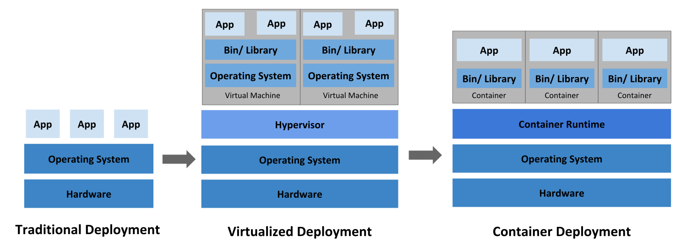

# 도커 컨테이너

> 외부의 영향을 받지 않는 독립된 환경 — 호스트의 커널을 공유하면서 프로세스·파일 시스템·네트워크를 격리한 실행 공간

## 컨테이너란

> 컨테이너 : 호스트 OS 위에서 다른 프로세스와 **격리되어 실행되는 프로세스**(와 그 실행 환경)

- 컨테이너 이미지를 실행하면 컨테이너가 됨
- 컨테이너 안에서는 자신만의 파일 시스템·프로세스 목록·네트워크를 가진 것처럼 보임
- 호스트에서 보면 컨테이너는 **하나의 프로세스**에 불과

| 격리 대상 | 컨테이너 안에서 보이는 모습 |
|---|---|
| 프로세스 | 자기 컨테이너의 프로세스만 보임 (PID 1부터 시작) |
| 파일 시스템 | 이미지에 담긴 파일로 구성된 독자적인 루트 디렉터리 |
| 네트워크 | 독자적인 IP 주소와 포트 |
| 호스트명·사용자 | 컨테이너별로 따로 가짐 |

---

## 파일 시스템의 격리

- 컨테이너는 호스트의 파일 시스템이 아니라 **이미지에 담긴 파일**을 루트(`/`)로 사용
- 컨테이너 A에서 파일을 바꿔도 호스트나 컨테이너 B에는 영향이 없음

```
호스트      /  ├─ bin  ├─ etc  ├─ var/lib/docker/...  (컨테이너의 실체는 이 안에 존재)
컨테이너 A  /  ├─ bin  ├─ etc  ├─ app      ← A의 이미지 내용만 보임
컨테이너 B  /  ├─ bin  ├─ etc  ├─ data     ← B의 이미지 내용만 보임
```

- 컨테이너마다 서로 다른 버전의 라이브러리를 가질 수 있음 → **의존성 충돌 방지**
- 호스트의 디렉터리를 컨테이너에 연결하고 싶으면 **볼륨/바인드 마운트**를 명시적으로 설정

---

## 컨테이너와 가상 서버의 차이

{ width=700 }

*출처: Kubernetes 공식 문서 (CC BY 4.0)*

| 구분 | 가상 서버 | 컨테이너 |
|---|---|---|
| 가상화 대상 | 하드웨어 | OS (프로세스 실행 환경) |
| 게스트 OS | 가상 서버마다 필요 | 없음 — 호스트 커널 공유 |
| 크기 | GB 단위 | MB 단위 |
| 기동 시간 | 분 단위 (OS 부팅) | 초 단위 (프로세스 시작) |
| 자원 효율 | OS만큼 오버헤드 | 오버헤드가 작아 고밀도 배치 |
| 격리 수준 | 강함 | 상대적으로 약함 (커널 공유) |
| OS 선택 | 자유 | 호스트 커널과 같은 계열만 |

---

## 어떻게 컨테이너에 운영 체제를 탑재할 수 있을까?

- 컨테이너에는 게스트 OS가 없는데 `ubuntu`, `centos`, `alpine` 같은 이미지가 존재

| OS의 구성 | 컨테이너에서 |
|---|---|
| 커널 | **호스트의 커널을 공유** — 이미지에 들어 있지 않음 |
| 커널 이외 (셸, 명령어, 라이브러리, 패키지 관리자 = 사용자 공간) | **이미지에 포함** |

- 즉 `ubuntu` 이미지는 우분투의 **커널을 뺀 나머지 파일들**
- 리눅스 배포판은 같은 리눅스 커널을 쓰므로, CentOS 호스트 위에서도 우분투 컨테이너가 동작
- 반대로 커널이 다른 OS(리눅스 호스트에서 Windows 컨테이너)는 실행 불가

---

## 컨테이너가 있다면 가상 서버는 필요 없을까?

| 가상 서버가 적합한 경우 | 컨테이너가 적합한 경우 |
|---|---|
| 호스트와 다른 OS·커널이 필요 | 같은 커널 위에서 여러 애플리케이션 실행 |
| 강한 격리가 필요 (서로 다른 고객의 환경 분리) | 빠른 기동·배포, 잦은 변경 |
| 커널 설정 변경, 커널 모듈 사용 | 높은 집적도, 자원 절약 |
| OS 전체를 관리해야 하는 기존 시스템 | 마이크로서비스, CI/CD |

- 둘은 경쟁이 아니라 **보완 관계** — 클라우드에서는 가상 서버 위에 컨테이너를 올려 사용

<details><summary>컨테이너의 격리가 가상 서버보다 약하다고 하는 이유는?</summary>

가상 서버는 각자 커널을 가지므로 한 가상 서버의 커널이 침해되어도 다른 가상 서버에 직접 영향이 가기 어렵다. <br>
컨테이너는 모든 컨테이너가 호스트의 커널 하나를 공유하므로, 커널 취약점이 악용되면 다른 컨테이너나 호스트까지 영향을 받을 수 있다. <br>
그래서 컨테이너를 루트 권한 없이 실행하거나, 강한 격리가 필요한 경우 가상 서버 단위로 나누는 구성을 사용한다.
</details>

---

## 🔑 최종 정리

> 한 줄 요약: 컨테이너는 호스트 커널을 공유하면서 프로세스·파일 시스템·네트워크를 격리한 독립 실행 환경으로, 이미지에는 커널을 뺀 OS의 사용자 공간만 담기기 때문에 가상 서버보다 가볍고 빠르지만 격리가 약하고 다른 커널의 OS는 쓸 수 없어, 가상 서버와 보완적으로 사용된다
