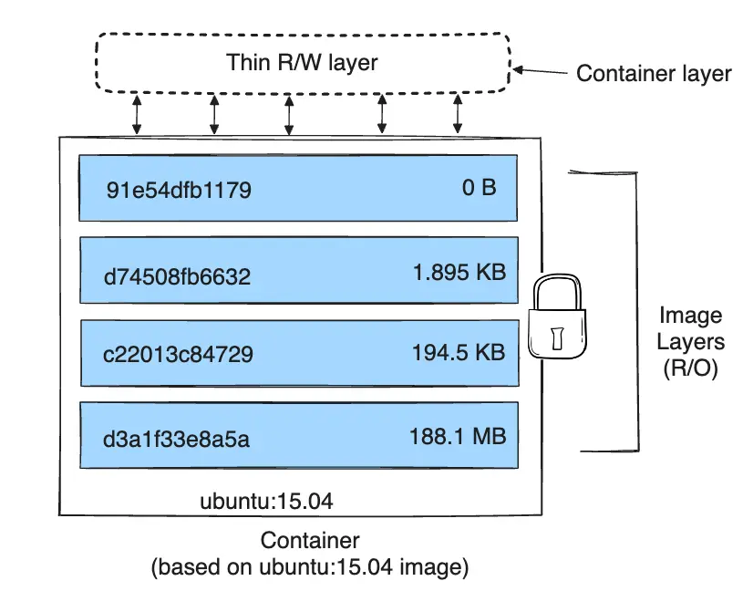
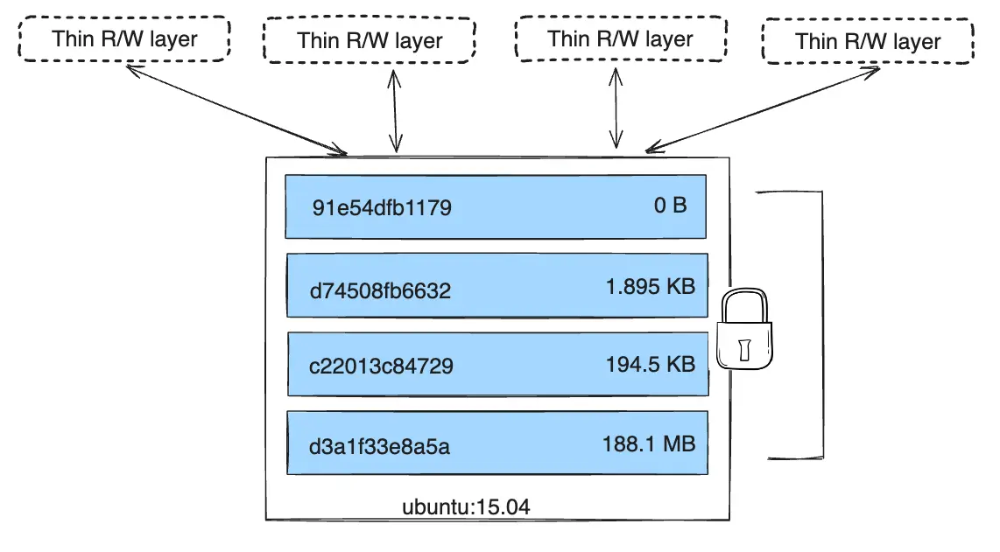

# 차분 관리

> 도커의 빠른 배포를 지원하는 방법 — 이미지를 레이어로 나누고 바뀐 부분(차분)만 저장·전송

## 차분 관리란

> 차분 관리 : 전체를 매번 복사하지 않고 **이전 상태와 달라진 부분(차분)** 만 기록·관리하는 방식

- 컨테이너 이미지는 여러 **레이어**가 겹쳐진 구조 — 각 레이어는 바로 아래 레이어와의 차이만 보유
- 유니온 파일 시스템(OverlayFS 등)이 여러 레이어를 겹쳐 **하나의 파일 시스템**처럼 보이게 함
- 도커 파일의 명령(`FROM`, `RUN`, `COPY` 등)마다 레이어가 하나씩 생성

{ width=600 }

*출처: Docker 공식 문서 (Apache License 2.0)*

---

## 이미지 레이어의 특징

| 특징 | 내용 |
|---|---|
| 읽기 전용 | 한 번 만들어진 레이어는 변경되지 않음 |
| 차분만 보유 | 아래 레이어에서 추가·변경·삭제된 파일만 기록 |
| 공유 | 같은 레이어는 여러 이미지가 함께 사용 — 디스크에 한 번만 저장 |
| 식별 | 내용의 해시값(다이제스트)으로 구분 → 같은 내용이면 같은 레이어 |
| 캐시 | 빌드 시 변경이 없는 레이어는 다시 만들지 않고 재사용 |

```
이미지 A : [ubuntu] ─ [python 설치] ─ [앱 A 복사]
이미지 B : [ubuntu] ─ [python 설치] ─ [앱 B 복사]
            └──── 공유되는 레이어 ────┘   └ 서로 다른 레이어만 따로 저장 ┘
```

---

## 컨테이너 레이어의 특징

> 컨테이너 레이어 : 컨테이너를 만들 때 이미지 레이어 **맨 위에 추가되는 쓰기 가능한 레이어**

| 특징 | 내용 |
|---|---|
| 읽기·쓰기 가능 | 컨테이너에서 일어난 파일 생성·변경·삭제가 여기에 기록 |
| 컨테이너마다 하나 | 같은 이미지로 만든 컨테이너들은 이미지 레이어를 공유하고 컨테이너 레이어만 각자 가짐 |
| 일시적 | 컨테이너를 삭제하면 함께 사라짐 |
| 얇음 | 변경분만 담으므로 컨테이너를 만들 때 이미지를 복사하지 않음 → 순식간에 기동 |

{ width=700 }

*출처: Docker 공식 문서 (Apache License 2.0)*

**쓰기 시 복사 (Copy-on-Write)**

| 동작 | 처리 |
|---|---|
| 읽기 | 위 레이어부터 아래로 찾아 내려가 처음 발견한 파일을 읽음 |
| 수정 | 이미지 레이어의 파일을 컨테이너 레이어로 **복사한 뒤** 수정 — 원본은 그대로 |
| 삭제 | 컨테이너 레이어에 "삭제됨" 표시(화이트아웃)만 기록 — 아래 레이어의 파일은 남아 있음 |

---

## 차분 관리의 장단점

| 장점 | 단점 |
|---|---|
| 같은 레이어를 공유해 **디스크 절약** | 레이어가 많아지면 파일 탐색에 오버헤드 |
| 없는 레이어만 push/pull → **전송 시간 단축** | 쓰기 시 복사 때문에 쓰기가 많은 처리는 느림 → 볼륨 사용 |
| 변경된 레이어부터만 다시 빌드 → **빌드 시간 단축** | 아래 레이어에서 지운 파일도 용량은 그대로 차지 |
| 컨테이너 기동이 빠름 (이미지를 복사하지 않음) | 한번 레이어에 들어간 비밀 정보는 뒤에서 지워도 남음 |

**레이어를 고려한 도커 파일 작성**

- **자주 바뀌는 것은 뒤쪽에** — 의존 라이브러리 설치를 먼저, 소스 코드 복사를 나중에 → 캐시 활용
- 설치와 정리를 **하나의 RUN**으로 묶기 → 불필요한 파일이 레이어에 남지 않음
- 멀티 스테이지 빌드로 빌드 도구는 버리고 결과물만 최종 이미지에 포함

<details><summary>소스 코드를 한 줄 고쳤는데 이미지 빌드와 배포가 금방 끝나는 이유는?</summary>

도커는 도커 파일의 각 명령을 레이어로 캐시해 두고, 변경이 생긴 명령부터만 다시 실행한다. <br>
베이스 이미지와 라이브러리 설치 레이어는 그대로 재사용되고 소스 코드를 복사하는 레이어만 새로 만들어진다. <br>
배포할 때도 레지스트리와 서버에 이미 있는 레이어는 건너뛰고 바뀐 레이어만 전송하므로 빠르다.
</details>

---

## 🔑 최종 정리

> 한 줄 요약: 도커는 이미지를 읽기 전용 레이어의 겹침으로 관리하고 컨테이너마다 얇은 쓰기 가능 레이어만 추가하는 차분 관리 방식을 사용해, 레이어 공유·캐시·쓰기 시 복사로 저장 공간과 빌드·전송·기동 시간을 줄이지만 쓰기 성능 저하와 삭제해도 남는 용량 같은 단점이 있다
