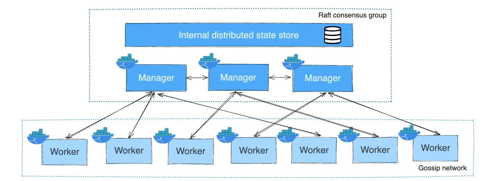
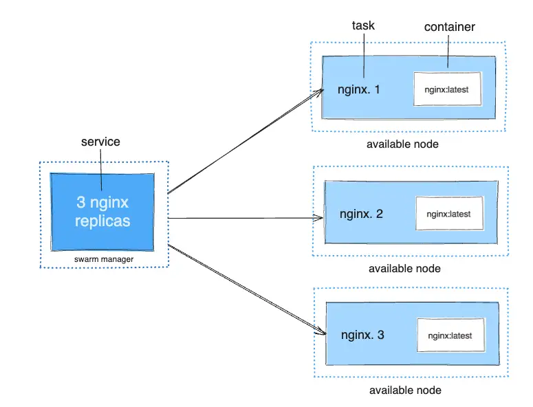

# 스웜 모드

> 클러스터를 관리하는 기능 — 여러 대의 도커 호스트를 하나로 묶어 컨테이너를 배치·복구·확장하는 도커 내장 오케스트레이션

## 스웜 모드란

> 스웜 모드(Swarm mode) : 여러 도커 호스트를 **하나의 클러스터(스웜)** 로 묶어 관리하는 도커 엔진의 내장 기능

- 클러스터 : 여러 대의 서버를 묶어 하나의 시스템처럼 동작하게 한 것
- 호스트 한 대로는 장애에 취약하고 처리 능력에 한계 → 여러 호스트에 컨테이너를 분산
- 별도 소프트웨어 설치 없이 `docker swarm init` 으로 시작 (도커 1.12부터 내장)

| 기능 | 내용 |
|---|---|
| 클러스터 관리 | 노드의 참가·이탈·상태 관리 |
| 원하는 상태 유지 | 지정한 수의 컨테이너가 항상 실행되도록 자동 복구 |
| 스케일링 | 컨테이너 수를 명령 하나로 증감 |
| 로드 밸런싱 | 어느 노드로 요청이 와도 서비스의 컨테이너로 분산 (라우팅 메시) |
| 롤링 업데이트 | 컨테이너를 순차적으로 새 버전으로 교체 |
| 서비스 디스커버리 | 서비스 이름으로 컨테이너에 접근 (내장 DNS) |

---

## 매니저와 워커

> 노드(node) : 스웜에 참가한 도커 호스트 — 역할에 따라 매니저와 워커로 구분

{ width=700 }

*출처: Docker 공식 문서 (Apache License 2.0)*

| 구분 | 매니저 노드 | 워커 노드 |
|---|---|---|
| 역할 | 클러스터 상태 관리, 태스크 배치(스케줄링), 명령 접수 | 매니저가 할당한 태스크(컨테이너) 실행 |
| 명령 실행 | `docker service` 등 관리 명령 가능 | 불가 |
| 컨테이너 실행 | 기본적으로 가능 (제외하도록 설정 가능) | 가능 |
| 장애 대비 | **Raft 합의** 알고리즘으로 상태를 복제 — 홀수 대(3, 5대) 구성 권장 | 장애 시 다른 노드에서 태스크 재실행 |

- 매니저가 N대일 때 (N-1)/2대까지의 장애를 견딤 → 3대면 1대, 5대면 2대

---

## 서비스와 태스크

| 용어 | 의미 |
|---|---|
| 서비스 (service) | "어떤 이미지를 몇 개 실행할지"를 정의한 **원하는 상태** — 사용자가 다루는 단위 |
| 태스크 (task) | 서비스를 이루는 실행 단위 — **컨테이너 1개**에 대응, 스웜이 노드에 배치 |

{ width=600 }

*출처: Docker 공식 문서 (Apache License 2.0)*

| 서비스 종류 | 내용 |
|---|---|
| 복제 서비스 (replicated) | 지정한 개수의 태스크를 클러스터에 분산 배치 |
| 글로벌 서비스 (global) | 모든 노드에 태스크를 하나씩 배치 (감시 에이전트, 로그 수집기) |

```bash
docker swarm init                                         # 스웜 초기화 (현재 노드가 매니저)
docker swarm join --token <토큰> <매니저 IP>:2377          # 다른 호스트를 스웜에 참가
docker service create --name web --replicas 3 -p 80:80 nginx   # 서비스 생성
docker service scale web=5                                # 태스크 수 변경
docker service update --image nginx:1.27 web              # 롤링 업데이트
```

- 태스크가 실행되던 노드가 멈추면 매니저가 다른 노드에 **새 태스크를 생성**해 개수를 유지

---

## 클러스터를 관리하는 도구

| 도구 | 개발 | 특징 |
|---|---|---|
| 도커 스웜 모드 | Docker | 도커에 내장, 구성이 간단, 도커 명령과 유사 — 소규모에 적합 |
| 쿠버네티스 | 구글 → CNCF | 기능이 풍부하고 생태계가 큼 — **사실상 표준** |
| Apache Mesos (Marathon) | Apache | 컨테이너 이외의 작업도 다루는 범용 클러스터 관리 |
| Nomad | HashiCorp | 단순하고 가벼움, 컨테이너 이외의 작업도 실행 |
| 아마존 ECS | AWS | AWS 전용 관리형 오케스트레이션 서비스 |

<details><summary>도커에 스웜 모드가 내장되어 있는데 왜 쿠버네티스가 더 널리 쓰일까?</summary>

스웜 모드는 배우기 쉽고 구성이 간단하지만 자동 스케일링, 세밀한 배포 제어, 확장 기능 등은 쿠버네티스가 훨씬 풍부하다. <br>
또한 주요 클라우드 사업자가 모두 관리형 쿠버네티스 서비스를 제공하고 주변 도구 생태계도 쿠버네티스를 중심으로 형성되었다. <br>
그래서 소규모·단순한 구성에는 스웜 모드, 대규모·복잡한 운영에는 쿠버네티스를 선택하는 경우가 많다.
</details>

---

## 🔑 최종 정리

> 한 줄 요약: 스웜 모드는 여러 도커 호스트를 클러스터로 묶는 도커 내장 오케스트레이션 기능으로, 매니저 노드가 Raft로 상태를 관리하며 워커 노드에 태스크를 배치하고, 사용자가 서비스로 원하는 상태를 선언하면 태스크(컨테이너) 수를 자동으로 유지·확장하며, 클러스터 관리 도구로는 쿠버네티스가 사실상 표준이다
