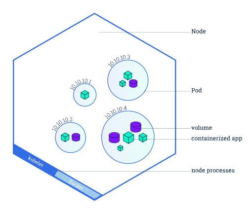

# 쿠버네티스

> 컨테이너의 관리 및 운영을 자동화하는 오케스트레이션 도구

---

## 쿠버네티스에서 가능한 것

| 기능 | 내용 |
|---|---|
| 헬스 체크와 자동 복구 | 멈춘 컨테이너를 재기동 |
| 스케일링 | 부하에 따라 컨테이너 수를 늘리고 줄임 |
| 엔드포인트 제공과 로드 밸런싱 | 고정된 IP로 접속하고 요청을 분산 |
| 롤링 업데이트·롤백 | 서비스를 멈추지 않고 새 버전으로 교체, 문제 시 되돌림 |

---

## 쿠버네티스에서 불가능한 것

> 쿠버네티스는 컨테이너를 **운영**하는 도구일 뿐, 애플리케이션 개발의 모든 것을 해 주지는 않음

- 자동 빌드 — 별도의 CI/CD 도구 필요
- 미들웨어 — 직접 컨테이너로 올려야 함
- 로그 수집·모니터링 — 기본 제공하지 않고 외부 도구와 연동
- 서버 자체의 구축·유지 보수 — 인프라는 따로 준비

---

## 컨테이너 오케스트레이션 도구의 사실상 표준

- 도커 스웜, 아파치 메소스 등과 경쟁했으나 쿠버네티스가 사실상 표준
- AWS(EKS)·GCP(GKE)·애저(AKS) 등 주요 클라우드가 모두 관리형 쿠버네티스 제공

---

## 쿠버네티스 클러스터란

> 클러스터 : 쿠버네티스가 관리하는 서버와 컨테이너의 집합

- 노드 : 클러스터를 구성하는 서버 한 대 

{ width=600 }

---

## 노드의 두 가지 유형

| 구분 | 마스터 노드 | 워커 노드 |
|---|---|---|
| 역할 | 워커를 제어 | 파드를 실제로 실행 |

---

## 🔑 최종 정리

> 한 줄 요약: 쿠버네티스는 사실상 표준 오케스트레이션 도구로, 복구·스케일링·로드 밸런싱·롤링 업데이트를 자동화하지만 이미지 빌드나 모니터링 등은 외부 도구가 필요하며, 클러스터는 전체를 제어하는 마스터 노드와 컨테이너를 실행하는 워커 노드로 구성된다
