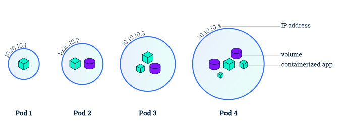

# 파드

> 쿠버네티스가 컨테이너를 관리하는 **최소 단위** — 하나 이상의 컨테이너로 구성

## 파드란

| 파드 내 컨테이너가 공유하는 것 | 내용 |
|---|---|
| 네트워크 | 파드마다 **IP 주소 하나** — 내부 컨테이너끼리는 `localhost`로 통신 |
| 스토리지 | 파드에 정의한 **볼륨**을 여러 컨테이너가 함께 마운트 |
| 생명 주기 | 같은 노드에 함께 배치되고 함께 생성·삭제 |

{ width=600 }

마운트가 뭐임?

---

## 파드의 필요성

- 파드 내에서 여러 컨테이너를 시작하면 쿠버네티스가 컨테이너를 관리할 수 있다

---

## 파드의 디자인 패턴

> 일반적으로 파드당 컨테이너 하나

> 메인 컨테이너에 보조 역할을 담당하는 사이드카 컨테이너를 추가

- 메인 컨테이너의 기능을 보완 

| 사용 예 | 내용 |
|---|---|
| 로그 수집 | 메인이 파일로 남긴 로그를 사이드카가 읽어 외부로 전송 |
| 프록시 | 통신을 가로채 암호화·재시도·감시 수행 |

---

## 🔑 최종 정리

> 한 줄 요약: 파드는 쿠버네티스가 관리하는 최소 단위로 하나 이상의 컨테이너가 IP 주소·볼륨·생명 주기를 공유하며, 메인 컨테이너를 고치지 않고 기능을 덧붙일 때 사이드카 컨테이너를 추가한다
