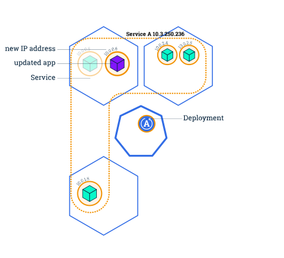

# 디플로이먼트 컨트롤러

> 파드의 개수와 버전을 **원하는 상태로 유지**해 주는, 오케스트레이션을 지원하는 가장 중요한 요소

## 레플리카셋이란

> 레플리카셋(ReplicaSet) : 똑같은 파드(레플리카)를 **지정한 개수만큼** 유지하는 객체

- 레플리카 : 같은 내용으로 복제된 파드
- 파드가 죽거나 노드가 멈춰 개수가 모자라면 새로 생성, 넘치면 삭제
- 어떤 파드가 자기 관리 대상인지는 **레이블**로 구분

| 구성 요소 | 내용 |
|---|---|
| replicas | 유지할 파드 개수 |
| selector | 관리 대상 파드를 고르는 레이블 조건 |
| template | 새 파드를 만들 때 쓰는 파드 정의(틀) |

- 한계 : 개수만 유지할 뿐, 이미지를 새 버전으로 **교체하는 절차**는 관리하지 못함

---

## 디플로이먼트란

> 디플로이먼트(Deployment) : 레플리카셋을 관리하며 파드의 **배포·갱신·롤백**을 담당하는 객체

```
디플로이먼트 ──관리──▶ 레플리카셋 ──관리──▶ 파드, 파드, 파드
```

| 기능 | 내용 |
|---|---|
| 롤링 업데이트 | 새 레플리카셋을 만들고 파드를 **조금씩** 새 버전으로 교체 → 무중단 갱신 |
| 롤백 | 이전 레플리카셋을 남겨 두어 문제 시 이전 버전으로 되돌림 |
| 이력 관리 | 리비전(revision) 단위로 변경 이력 보관 |
| 스케일링 | replicas 값 변경으로 파드 수 조절 |

{ width=600 }

*출처: Kubernetes 공식 문서 (CC BY 4.0)*

- 실무에서는 파드나 레플리카셋을 직접 만들지 않고 **디플로이먼트**를 만들어 사용

---

## 컨트롤러란

> 컨트롤러 : 객체의 **현재 상태**를 감시하며 **원하는 상태**와 같아지도록 조정하는 프로그램

```
관찰 (현재 상태 확인) → 비교 (원하는 상태와 차이) → 조치 (차이를 없앰) → 반복
```

- 이 반복을 **조정 루프**(reconciliation loop)라고 함 — 에어컨의 온도 조절기와 같은 원리
- 사용자는 절차가 아니라 결과만 선언 → 나머지는 컨트롤러가 수행 (**선언형**)

| 컨트롤러 | 관리 대상 |
|---|---|
| 레플리카셋 컨트롤러 | 파드 개수 |
| 디플로이먼트 컨트롤러 | 레플리카셋과 갱신 절차 |
| 스테이트풀셋 컨트롤러 | 순서·고유 이름·저장소가 필요한 파드 (DB 등) |
| 데몬셋 컨트롤러 | 모든 노드에 하나씩 두는 파드 (로그 수집기 등) |
| 잡 컨트롤러 | 한 번 실행하고 끝나는 처리 |

---

## 디플로이먼트 컨트롤러란

- 디플로이먼트 객체를 감시하며 그 내용대로 레플리카셋을 만들고 조정하는 컨트롤러
- 마스터 노드의 kube-controller-manager 안에서 동작

**이미지를 새 버전으로 바꿨을 때의 동작**

| 순서 | 동작 |
|---|---|
| 1 | 디플로이먼트의 파드 정의(template) 변경을 감지 |
| 2 | 새 버전용 레플리카셋 생성 (파드 0개) |
| 3 | 새 레플리카셋의 파드를 늘리고, 기존 레플리카셋의 파드를 줄임 |
| 4 | 3을 반복해 모두 교체 — 기존 레플리카셋은 0개인 채로 보관 (롤백용) |

<details><summary>레플리카셋이 있는데 왜 디플로이먼트를 쓸까?</summary>

레플리카셋은 파드 개수를 유지할 뿐이라, 이미지를 바꿔도 이미 떠 있는 파드는 그대로 둔다. <br>
새 버전으로 바꾸려면 파드를 직접 지우거나 레플리카셋을 새로 만들어야 한다. <br>
디플로이먼트는 버전별 레플리카셋을 만들어 단계적으로 교체하고 이전 것을 남겨 두므로 무중단 갱신과 롤백이 가능하다.
</details>

---

## 🔑 최종 정리

> 한 줄 요약: 레플리카셋은 같은 파드를 지정한 개수만큼 유지하고, 디플로이먼트는 레플리카셋을 버전별로 관리해 롤링 업데이트와 롤백을 제공하며, 컨트롤러는 현재 상태를 원하는 상태에 맞추는 조정 루프를 반복하는 프로그램으로 디플로이먼트 컨트롤러가 이 갱신 절차를 자동으로 수행한다
