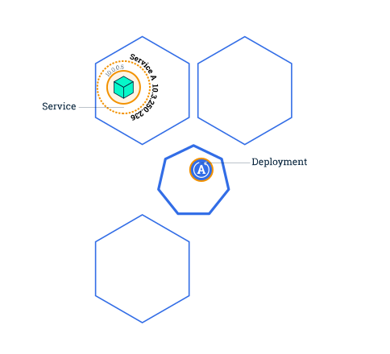
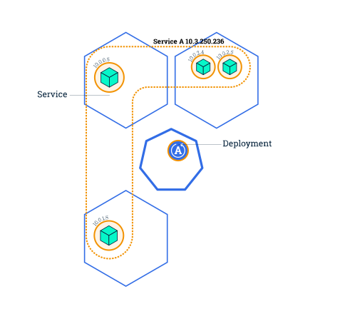

# 스케일링

> 부하에 맞춰 처리 능력을 늘리고 줄여 **시스템의 성능을 향상**시키는 방법

## 스케일링이란

- 요청량 변화에 맞춰 시스템의 처리 능력을 조절하는 것
- 부족하면 응답 지연·장애, 남으면 비용 낭비 → **필요한 만큼만** 확보하는 것이 목표
- 쿠버네티스는 지표(CPU·메모리 사용률 등)를 보고 **자동으로** 조절 가능 (오토스케일링)

---

## 스케일링하는 방법

| 구분 | 수평 스케일링 | 수직 스케일링 |
|---|---|---|
| 방법 | **개수**를 늘리고 줄임 | 하나의 **성능**(CPU·메모리)을 높이고 낮춤 |
| 용어 | 스케일 아웃 / 스케일 인 | 스케일 업 / 스케일 다운 |
| 한계 | 이론상 계속 추가 가능 | 노드(서버) 성능이 상한 |
| 가용성 | 여러 개라 일부가 멈춰도 지속 | 하나뿐이면 멈출 때 영향 큼 |
| 적합한 대상 | 상태가 없는(stateless) 웹·API 서버 | 나누기 어려운 처리 (DB 등) |
| 주의점 | 상태를 외부 저장소로 빼야 함 | 변경 시 재기동이 필요할 수 있음 |

---

## 쿠버네티스에서 파드의 수평 스케일링

> **HPA**(Horizontal Pod Autoscaler) : 지표에 따라 디플로이먼트 등의 **파드 개수(replicas)**를 자동 조절

{ width=600 }

{ width=600 }

*출처: Kubernetes 공식 문서 (CC BY 4.0)*

- 메트릭 서버가 수집한 사용률과 목표값을 비교해 필요한 개수를 계산

```
필요한 파드 수 = 현재 파드 수 × (현재 사용률 ÷ 목표 사용률)
예) 4개 × (80% ÷ 50%) = 6.4 → 7개
```

```bash
kubectl scale deployment web --replicas=5                           # 수동
kubectl autoscale deployment web --min=2 --max=10 --cpu-percent=50  # 자동(HPA)
```

- 늘어난 파드는 서비스의 엔드포인트에 자동 등록 → 로드 밸런싱 대상에 포함
- 사용률 계산의 기준이 되므로 파드에 **자원 요청량(requests)** 설정이 필요

---

## 쿠버네티스에서 파드의 수직 스케일링

> **VPA**(Vertical Pod Autoscaler) : 실제 사용량을 보고 파드의 **CPU·메모리 요청량**을 자동 조절

| 자원 설정 | 의미 |
|---|---|
| requests | 파드가 보장받는 최소 자원 — 스케줄러가 배치할 노드를 고르는 기준 |
| limits | 파드가 쓸 수 있는 최대 자원 — 초과 시 CPU는 제한, 메모리는 강제 종료(OOM) |

- 적정 자원량을 모를 때 과다·과소 할당을 바로잡는 데 유용
- 값을 적용하려면 파드를 **다시 만드는** 것이 기본 동작 → 순간적인 중단 고려 필요
- 같은 지표(CPU·메모리)로 HPA와 VPA를 동시에 걸면 서로 충돌 → 함께 쓰지 않음

---

## 클러스터 자체의 수평 스케일링

> **클러스터 오토스케일러**(Cluster Autoscaler) : **워커 노드 수**를 자동으로 늘리고 줄임

| 상황 | 동작 |
|---|---|
| 자원 부족으로 배치되지 못한(Pending) 파드 발생 | 노드 **추가** |
| 사용률이 낮은 노드가 일정 시간 지속 | 파드를 다른 노드로 옮기고 노드 **삭제** |

- 파드를 아무리 늘려도 올릴 노드가 없으면 소용없음 → 파드 스케일링과 노드 스케일링을 함께 사용
- 클라우드의 가상 서버 그룹(오토스케일링 그룹 등)과 연동해 동작

```
부하 증가 → HPA가 파드 증가 → 노드 자원 부족(Pending) → 클러스터 오토스케일러가 노드 추가
```

<details><summary>웹 서버에는 왜 수직보다 수평 스케일링을 주로 쓸까?</summary>

수직 스케일링은 노드 한 대의 성능이 상한이고, 적용할 때 파드를 다시 만들어야 한다. <br>
수평 스케일링은 파드를 추가하기만 하면 되어 무중단으로 늘릴 수 있고, 여러 개로 분산되어 일부가 멈춰도 서비스가 유지된다. <br>
단, 세션 같은 상태를 파드 안에 두지 않고 외부 저장소에 두어야 어느 파드가 받아도 같은 결과를 낼 수 있다.
</details>

---

## 🔑 최종 정리

> 한 줄 요약: 스케일링은 부하에 맞춰 처리 능력을 조절하는 것으로 개수를 바꾸는 수평과 성능을 바꾸는 수직이 있으며, 쿠버네티스는 파드 수를 조절하는 HPA, 파드의 자원 요청량을 조절하는 VPA, 워커 노드 수를 조절하는 클러스터 오토스케일러로 이를 자동화한다
