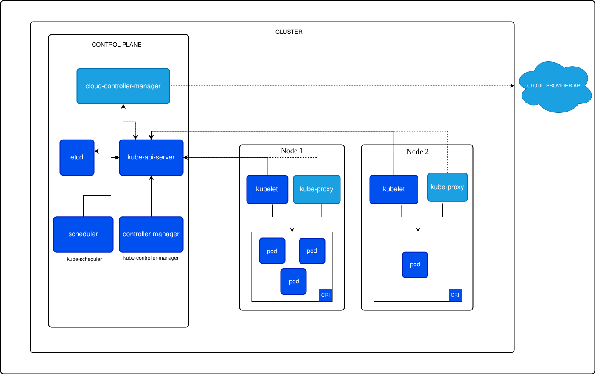

# 쿠버네티스의 아키텍처

> 클러스터를 제어하는 마스터와 컨테이너를 실행하는 워커 — **각 노드에서 동작하는 구성 요소**

## 쿠버네티스 아키텍처

- 마스터 노드(컨트롤 플레인) : 클러스터 전체를 **관리·제어**하는 구성 요소가 동작
- 워커 노드 : 마스터의 지시를 받아 **파드를 실행**하는 구성 요소가 동작
- 모든 구성 요소는 **API 서버**를 통해서만 서로 정보를 주고받음

{ width=600 }

*출처: Kubernetes 공식 문서 (CC BY 4.0)*

---

## 쿠버네티스 클러스터를 조작하는 방법

| 방법 | 내용 |
|---|---|
| kubectl | 명령줄 도구 — 가장 일반적 |
| 대시보드 | 웹 화면으로 조회·조작 |
| REST API 직접 호출 | 프로그램·CI/CD 도구가 사용 (클라이언트 라이브러리) |

- 어떤 방법이든 결국 **kube-apiserver에 요청**을 보내는 것

**`kubectl apply`로 디플로이먼트를 만들 때의 흐름**

```
kubectl ──▶ kube-apiserver ──▶ etcd에 원하는 상태 저장
              ▲    ▲    ▲
              │    │    └── kube-controller-manager : 부족한 파드를 감지해 파드 객체 생성
              │    └─────── kube-scheduler : 파드를 실행할 노드 결정
              └──────────── kubelet (워커) : 자기 노드에 배정된 파드의 컨테이너 기동
```

---

## 마스터의 구성 요소

| 구성 요소 | 역할 |
|---|---|
| kube-apiserver | 클러스터의 **창구** — 모든 요청을 받아 인증·검증 후 처리, 유일하게 etcd와 통신 |
| etcd | 클러스터의 모든 상태·설정을 저장하는 **분산 키-값 저장소** |
| kube-scheduler | 새 파드를 **어느 노드에 배치할지** 결정 (자원 여유, 제약 조건 고려) |
| kube-controller-manager | 레플리카셋·디플로이먼트·노드 등 각종 **컨트롤러**를 실행 — 현재 상태를 원하는 상태로 조정 |
| cloud-controller-manager | 클라우드의 로드 밸런서·스토리지 등과 연동 (클라우드 환경에서만) |

- etcd의 데이터가 사라지면 클러스터 상태를 잃음 → **백업**과 다중화(홀수 대, 보통 3대 이상)가 중요
- 스케줄러는 배치할 노드를 **정할** 뿐, 실제 컨테이너 기동은 그 노드의 kubelet이 수행

---

## 워커의 구성 요소

| 구성 요소 | 역할 |
|---|---|
| kubelet | 노드의 **에이전트** — API 서버를 지켜보다 자기 노드에 배정된 파드를 기동·감시(프로브), 상태를 보고 |
| kube-proxy | 서비스 IP로 온 통신을 파드로 전달하는 **네트워크 규칙**(iptables/IPVS) 관리 |
| 컨테이너 런타임 | 이미지를 내려받아 컨테이너를 **실제로 실행** — containerd, CRI-O |

```
kubelet ──CRI──▶ 컨테이너 런타임 (containerd) ──▶ 컨테이너
```

- 이 밖에 파드 간 네트워크를 담당하는 CNI 플러그인(flanneld 등)이 각 노드에서 동작
- 마스터 노드에도 kubelet·kube-proxy가 동작 — 마스터의 구성 요소 자체가 파드로 실행되는 경우가 많기 때문

**구성 요소 정리**

| 질문 | 담당 |
|---|---|
| 요청을 받는 곳은? | kube-apiserver |
| 상태를 기억하는 곳은? | etcd |
| 어디에 놓을지 정하는 것은? | kube-scheduler |
| 원하는 상태를 유지하는 것은? | kube-controller-manager |
| 실제로 컨테이너를 띄우는 것은? | kubelet + 컨테이너 런타임 |
| 서비스의 통신을 전달하는 것은? | kube-proxy |

<details><summary>왜 모든 구성 요소가 API 서버만 거쳐서 통신할까?</summary>

상태를 읽고 쓰는 경로가 하나로 모이면 인증·권한 검사·검증을 한곳에서 할 수 있고 etcd의 일관성을 지키기 쉽다. <br>
각 구성 요소는 서로를 직접 호출하지 않고 API 서버의 변화를 지켜보다 자기 일만 하므로 서로 독립적이다. <br>
덕분에 구성 요소 하나가 잠시 멈춰도 다시 살아나면 현재 상태를 보고 이어서 처리할 수 있다.
</details>

---

## 🔑 최종 정리

> 한 줄 요약: 쿠버네티스는 kubectl 등의 요청을 받는 kube-apiserver를 중심으로, 마스터에서는 상태를 저장하는 etcd·배치를 결정하는 kube-scheduler·상태를 조정하는 kube-controller-manager가, 워커에서는 파드를 기동·감시하는 kubelet·서비스 통신을 전달하는 kube-proxy·컨테이너를 실행하는 컨테이너 런타임이 동작한다
